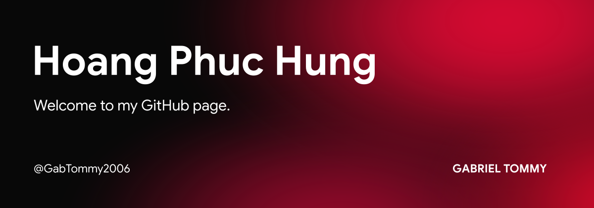

  

<h1 align="center">Hi 👋, I'm Gabriel Tommy!</h1>

<h3 align="center">Learning, building, and turning ideas into something useful.</h3>

  Hi! I'm Hoàng Phúc Hưng, also known by my nickname, Gabriel Tommy.
  I'm currently a third-year student at the
  <a href="https://vnuk.udn.vn/en/about-us/">VN-UK Institute for Research and Executive Education (VNUK), the University of Danang</a>.

  I love figuring things out on my own, exploring new things, and... occasionally breaking them.
  I'm still learning and practicing, with the hope of becoming someone who makes a positive contribution to society.
  I have a lot of experience to gain and can be a little dumb sometimes,
  but I'm determined to keep improving and become a better version of myself every day.

  

---

- 🌱 I'm learning to become a **full-stack developer**.
- 💭 Sometimes I'm a little silly and tend to let my mind wander.
- 🎯 My goal in this field is to put my skills to work, **solve problems for others**, and improve myself every day.
- 🛠️ Honestly, I learn new things by... **figuring them out myself and getting hands-on**. Theory isn't exactly my strong suit.
- 📚 You can get a glimpse of my learning journey through [my repositories](https://github.com/GabTommy2006?tab=repositories).
- 📬 Reach me at **[hungmc.060606@gmail.com](mailto:hungmc.060606@gmail.com)**.
- 🫀 Fun fact: I was born with a **congenital heart condition called APSO-3**. So you might notice that I seem a little frail, even though I look like anyone else on the outside.

## Languages & Tools

Technologies I'm exploring through my projects:

  &nbsp;
  &nbsp;
  &nbsp;
  &nbsp;
  &nbsp;
  &nbsp;
  &nbsp;
  

## My GitHub Journey

Every project is another chance to practice, learn, and build something better.

<!-- Live third-party cards. Keep these URLs remote so their data can refresh.
Stats: github.com/vn7n24fzkq/github-profile-summary-cards
Streak: github.com/DenverCoder1/github-readme-streak-stats
Views: github.com/antonkomarev/github-profile-views-counter -->

  

  

[Explore my projects →](https://github.com/GabTommy2006?tab=repositories)
&nbsp;·&nbsp;
[See my contributions →](https://github.com/GabTommy2006?tab=overview)

---

  Thanks for stopping by. Let's keep learning and building!

